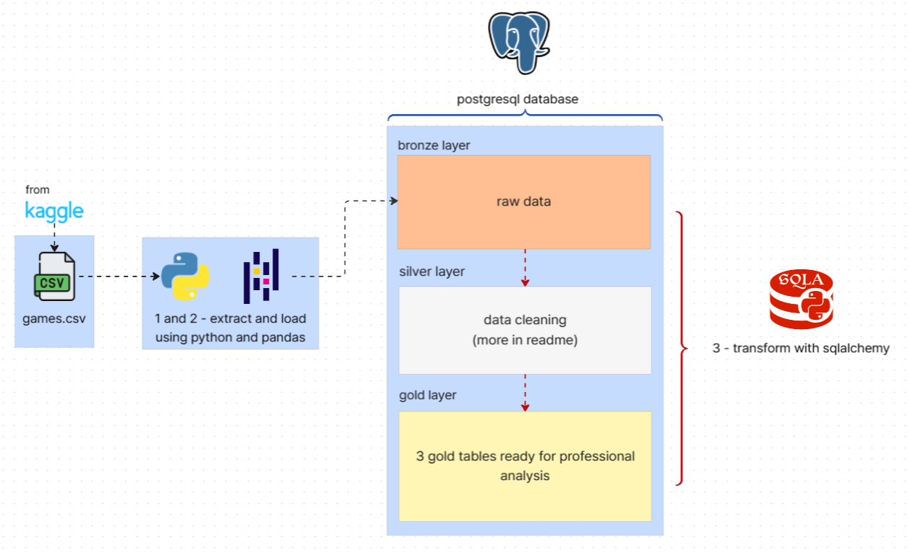
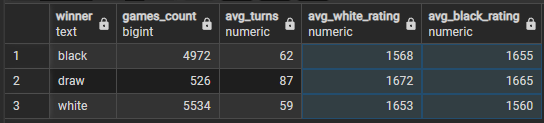

# lichess-data-pipeline
An ELT pipeline built on a real chess dataset, organised in the medallion architecture (Bronze -> Silver -> Gold). Python/Pandas load the data, Postgres stores it, and SQL through sqlalchemy engine does the transformations and aggregations.

#### tech stack: Python, Pandas, PostgreSQL, SQLAlchemy

## 1. Project goal

The goal is to practise the core data engineering workflow end to end: ingesting raw data, cleaning it, modelling it in layers and producing analytics-ready tables. The focus is on understanding trade-offs in data cleaning (what to drop, what to flag, and why), not just on running queries.


## 2. Data source

The dataset is from kaggle and it contains real chess games recorded from [lichess](https://lichess.org/) site.

link:
https://www.kaggle.com/datasets/datasnaek/chess

## 3. Architecture 



Python and pandas loads 'games.csv' file into postgres database. From now on sqlalchemy sends SQL queries to postgres.

## 4. Folder structure

``` bash
lichess-data-pipeline
├─ data
│  └─ games.csv
├─ media
│  ├─ architecture.png
│  └─ result_statistics.png
├─ README.md
├─ requirements.txt
├─ sql
│  ├─ checks
│  │  └─ data_quality_checks.sql
│  ├─ gold
│  │  ├─ opening_statistics.sql
│  │  ├─ result_statistics.sql
│  │  └─ time_control_statistics.sql
│  └─ silver
│     ├─ create_silver_table.sql
│     └─ insert_silver_data.sql
└─ src
   ├─ extract_load.py
   └─ transform.py
```


## 5. Roadmap 

main goals:
- [ ] error handling
- [ ] dockerize everything
- [ ] dashboards

less significant goals:
- [ ] split the names of openings (opening name/variation)
- [ ] run whole pipeline from one 'main.py' file
- [ ] flag invalid timestamps records (created_at == last_move_at)

## 6. Medallion architecture layers explained

### Bronze

Raw data loaded from the CSV without modification.

### Silver

#### Transformed data:

- column types fixed,  
- inconsistent records filtered out,
- duplicates removed,
- [text consistency checked](sql/checks/data_quality_checks.sql).

#### What I did specifically:
- deleted 8548 of 20058 rows (~42%) where 'created_at' equals 'last_move_at'. One of my goals in roadmap is flagging them all, because losing this much rows is a big waste of data.

### Gold

#### Created 3 aggregated tables ready for analysis:  
1. [opening_statistics](sql/gold/opening_statistics.sql) - which opening has highest winrate for x?
2.  - results are split into 3 for black, white and draws
3. [time_control_statistics](sql/gold/time_control_statistics.sql) - data for analyzing everything related to time


## 7. Requirements

- Python version >= 3.11.3   
- pip version >= 26.2.1  
- PostgreSQL/pgAdmin4 version >= 9.17 installed locally
- Packages included in requirements.txt installed  


## 8. How to run

1. Clone the repository:
```bash
   git clone https://github.com/Michal-tat/lichess-data-pipeline.git
   cd lichess-data-pipeline
```
2. Install dependencies:
```bash
   pip install -r requirements.txt
```
3. Copy `.env.example` to `.env` and fill in your database credentials:
```bash
   cp .env.example .env
```

4. Create database in pgAdmin4. Name of database should be same as in .env file (DB_NAME=) variable.

5. Run the pipeline:
```bash
   python src/extract_load.py
   python src/transform.py
```
 

## 9. Results

#### One of gold layer tables:


## 10. What I learned

- how medallion architecture works in practice
- schemas in sql
- ways of transforming data. For example: CREATE TABLE 'x' AS SELECT
- new technology: sqlalchemy and running queries in python with it


## 11. AI usage
I started by building everything I already knew how to do on my own. Once I had a working version, I asked AI to review my code and point out mistakes or areas for improvement. When I got stuck on something I didn't know how to do, I asked AI for hints and guidance rather than complete solutions, so I could reach the answer on my own. I can explain every part of this repository.


## 12. License

This project is licensed under the MIT License. See [LICENSE](LICENSE) for details.
